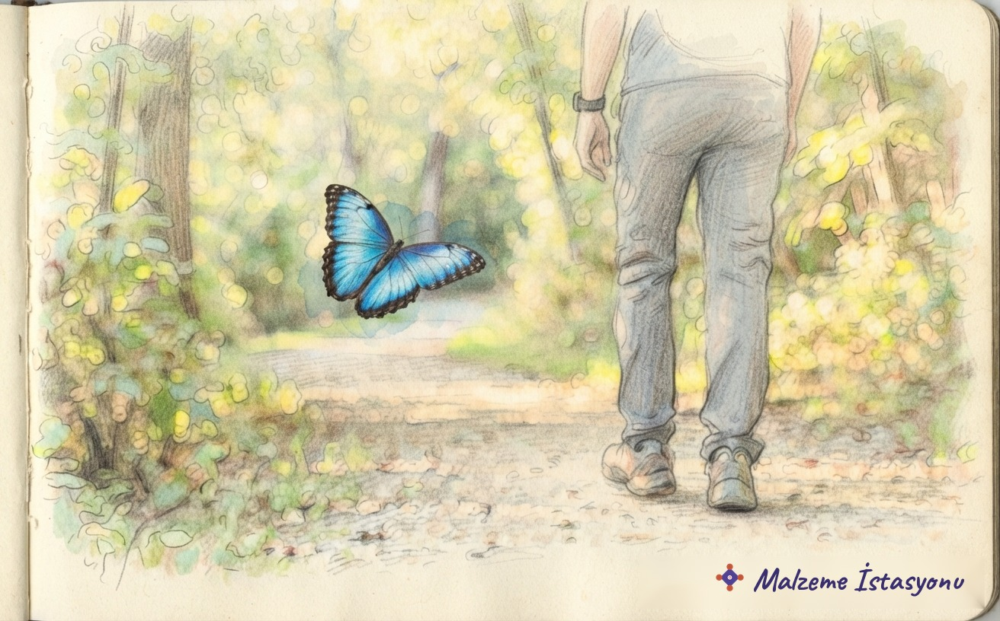
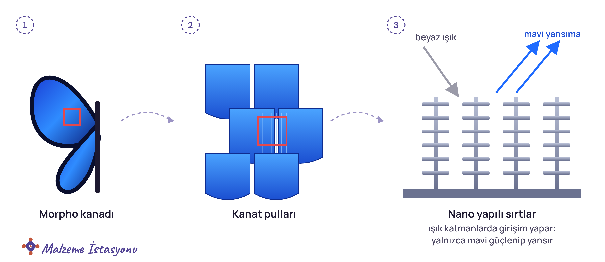
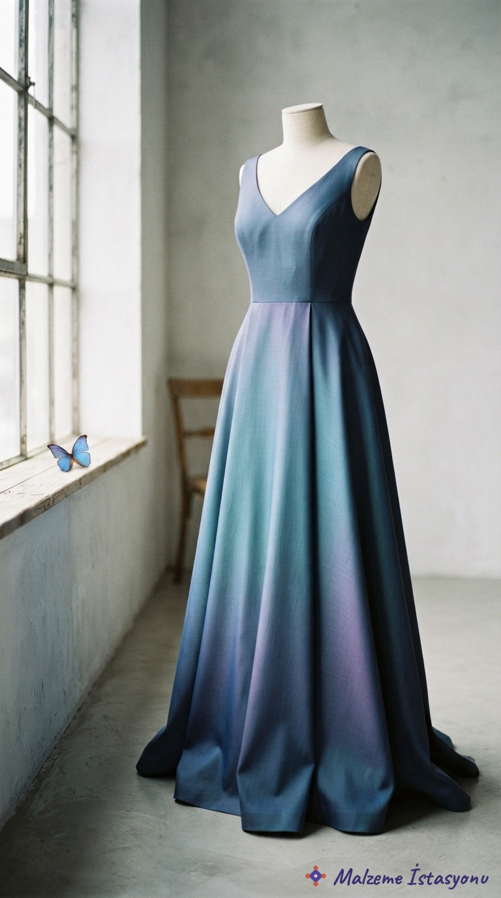

<figure>
  
  <figcaption>Yürüyüş yolunda bir Morpho kelebeği Görsel: Gemini (yapay zekâ) ile üretilmiştir</figcaption>
</figure>

Yorucu geçen iş günlerinin yorgunluğunu atmanın en garanti yolu açık havada yürümektir. Temiz hava insanı hafifletir. Ayaklar belli bir tempoyu yakalayınca artık görevi gözler devralır. Sonra da beyin işi bitirir.

**Nasıl yani?**

Yürürken temel motivasyonunuz yalnızca anda kalıp keyif almak olursa, gözlem yeteneğiniz tavan yapar ve beyniniz size, gördüklerinizle bağlantı kurabileceğiniz ve işinize yarayabilecek senaryolar sunmaya başlar. Tam da böyle anlarda doğadan ilham alınır; yani malzeme dünyasında biyomimikri ile yeni fikirler doğar.

**Örnek verelim.**

Güneş ılık ılık yüzünüze vururken, birden masmavi bir **[Morpho kelebeği](https://www.britannica.com/animal/morpho-insect "Kaynak: britannica.com")** geçiverdi önünüzden. Kelebeğin kanatlarındaki renk geçişleri sizi büyüledi. Mavi kanatların eteklerinin siyah çizgilerle son bulması ve kanatlarını kapattığında göz efekti veren noktalı renk cümbüşü kelebeğe mükemmel bir kamuflaj yeteneği verse de siz bu güzelliğin farkına varabildiniz.

**Ne şanslısınız!**

İşte tam o anda zihninizin soru sormasına izin verdiniz ve merakınız sizi yeni keşiflere sürükledi.

**Ne gizli bu kelebeğin kanatlarında?**

Kısa bir araştırmayla sorunuzun cevabını bulabilirsiniz, hem de **[bilimsel kanıtlarla](https://doi.org/10.1098/rspb.1999.0794 "Kaynak: Proceedings of the Royal Society B")** :) Kelebeğin kanatlarında mavi tonlarda parlayan renk geçişinin temel sebebi, kanatların nano yapısının ışığın kırılmasına ve yansımasına imkân sağlamasıdır. Güneş ışınları, doğal bir ***[fotonik kristal](https://tr.wikipedia.org/wiki/Fotonik_kristal "Kaynak: tr.wikipedia.org")*** gibi davranan kelebeğin nano yapılı kanat pullarıyla buluşunca ortaya büyüleyici bir güzellik çıkar.

<figure class="diagram">
  
  <figcaption>Morpho kelebeğinin kanadından nano yapılı sırtlara: mavi renk pigmentten değil, yapıdan gelir Kanat pulunun gerçek elektron mikroskobu görüntüsü için: <a href="https://mse.utoronto.ca/future/nanontario/" title="Kaynak: mse.utoronto.ca"><strong>nanOntario</strong></a></figcaption>
</figure>

**Bunu fark etmen neyi mi değiştirir?**

Tıpkı **[Morphotex](https://www.nanotechproject.tech/cpi/products/morphotex-r-fiber/ "Kaynak: nanotechproject.tech")**’in yaptığı gibi, kimyasal boyalarla kumaşı yıpratmadan ve tabii ki müşterinin sağlığını riske atmadan farklı renkleri doğal olarak tek bir kumaşta buluşturabilirsin. Bu mükemmel fikir, kalınlıkları 70 ile 100 nm arasında değişen polyester ve naylon ipliklerle kelebeğin pul yapısının taklit edilmesi ve aynı görsel etkiyi elde etmek için ipliklerin dikkatlice lamine edilmesiyle hayat buldu. Bu kumaştan yapılmış bir **[tasarım elbiseyi](https://donnasgro.com/Morphotex-Dress "Kaynak: donnasgro.com")** görmek için tıklayabilirsin.

<figure style="max-width:380px;margin-left:auto;margin-right:auto">
  
  <figcaption>Morpho kelebeğinden ilham alan, boyasız renklerin hayal edildiği bir elbise Görsel: Gemini (yapay zekâ) ile üretilmiştir</figcaption>
</figure>

Ne dersin, yürürken kaçırdığın çok şey vardır belki de? :)

## Kaynakça

1. Vukusic, P., Sambles, J. R., Lawrence, C. R., & Wootton, R. J. (1999). Quantified interference and diffraction in single Morpho butterfly scales. *Proceedings of the Royal Society B*, 266(1427), 1403–1411. [https://doi.org/10.1098/rspb.1999.0794](https://doi.org/10.1098/rspb.1999.0794)
2. Kinoshita, S., Yoshioka, S., & Kawagoe, K. (2002). Mechanisms of structural colour in the Morpho butterfly: cooperation of regularity and irregularity in an iridescent scale. *Proceedings of the Royal Society B*, 269(1499), 1417–1421. [https://doi.org/10.1098/rspb.2002.2019](https://doi.org/10.1098/rspb.2002.2019)
3. NASA Tech Briefs (2011). Butterfly-inspired fibers create diverse fabric colors. [https://www.techbriefs.com/component/content/article/10570-butterfly-inspired-fibers-create-diverse-fabric-colors](https://www.techbriefs.com/component/content/article/10570-butterfly-inspired-fibers-create-diverse-fabric-colors)
4. Transmaterial. Morphotex: Chromagenic fiber (Teijin Fibers Limited). [https://transmaterial.net/morphotex](https://transmaterial.net/morphotex)
5. Project on Emerging Nanotechnologies. Morphotex® Fiber (Teijin Fibers Limited). [https://www.nanotechproject.tech/cpi/products/morphotex-r-fiber/](https://www.nanotechproject.tech/cpi/products/morphotex-r-fiber/)
