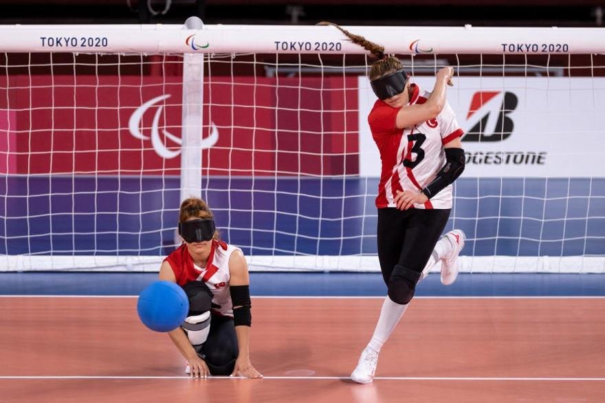
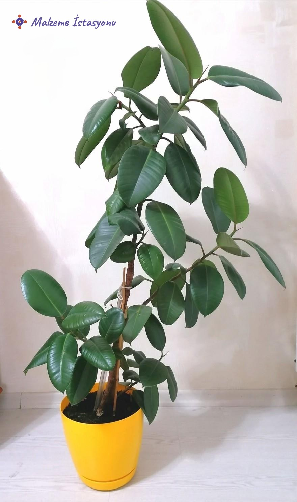

*Golbol Türkiye 2021*

<figure>
  
  <figcaption><a href="https://www.koza24.com/">Golbol Türkiye Takımı oyuncuları</a>: Sevda Altınoluk (resimde topu fırlatan ve takıma birçok sayı kazandıran tecrübeli golcü) ve gelen topları tutarak rakibe gol fırsatı vermeyen Reyhan Yılmaz. Fotoğraf: koza24.com</figcaption>
</figure>

Sporla aran nasıldır? Genelde fazla kaçırdığın günlerde evine en yakın yürüyüş parkuruna giderek üç beş tur atanlardan mısın, yoksa spor müsabakalarını canlı izleyemeyince içi içini yiyenlerden mi?

Evet efendim, ikisi de benim diyorsan o daha güzel.

O hâlde olimpiyatlarda yarışan atletleri izlerken, müsabaka sonunda nefes nefese bitiş çizgisine ulaşmalarını görünce onların azmine hayran kalıyor ve kendilerini dinlenmek için yere atışlarını görünce de seviniyorsundur. İnsan empati yapabildiği durumlarda daha az yargılayıcı oluyor malum. Yarışı kazanmaktan çok bitirebilmenin önemini de anlıyorsundur tahminimce. Ancak bazen empati yapmanın da ötesinde şartları çok iyi bilmemiz gerekebilir sporcunun verdiği savaşı izlerken.

Tokyo'da gerçekleşen ***Paralimpik Olimpiyatları*** büyük bir heyecanla takip ettim bu sene. İnsanların tüm engelinin bedeninde değil zihninde olduğunu bir kez daha anlamış oldum. Özellikle, bize ikinci altın madalyayı getiren ***Golbol Türkiye Kadın Milli Takımı***'nın müsabakaları bana ayrı bir heyecan verdi. Tokyo ile aramızdaki saat farkına rağmen maçları canlı izlemek için gece gündüz demeden saatimi kurdum, televizyonun başına kuruldum.

Bu oyunda rakipler 3'er oyuncu ile sahaya çıkıyor; saha 18 metre uzunluğunda ve 9 metre genişliğinde. [Kalelerin](https://olympics.com/) genişliği de 9'ar metre. Oyuncular genelde orta sahada, sağ ve sol köşelerde yerlerini koruyarak atışları gerçekleştiriyor. Ellerinde tuttukları topu 10 saniye içerisinde, yere çarpması şartıyla karşı kaleye atarak gol bulmayı hedefleyen bir oyun. Sporcular görme engelli olmalarına rağmen gözlerine ***"blockout"*** denilen göz maskelerini takmaları gerekiyor, çünkü her sporcunun engel seviyesi aynı olmayabiliyor. Tabii durum böyle olunca ***nasıl oluyor da rakip kaleye gol atmak mümkün hâle gelir diyebilirsiniz.***

***Yine yolun sonu malzemelere çıkıyor!***

Nasıl mümkün, anlatıyorum. Oyunda kullanılan top, öyle futbol maçlarında görmeye alışık olduğumuz 450 gramlık toplardan değil. Mavi renkli topun üzerinde toplam 8 delik, içinde ise 2 adet zil bulunuyor. Dahası bu top [yaklaşık](https://www.usaba.org/) 1,25 kg ağırlığında ve 25 cm çapında. Topun delikli ve içinde zil olmasının sebebi, oyuncuların topun yönünü ve hızını anlamalarını sağlayarak kaleyi korumalarına ya da gol atmalarına yardımcı olmak. Görme duyusunun ortadan kaldırıldığı bu spor dalında elbette işitme duyusundan yararlanmak oldukça mantıklı.

***Peki, şimdi bir düşünelim.***

Sporcularımız topu ve rakiplerinin kalenin neresinde olduğunu göremiyor. Hareket eden topun içindeki zillerin çıkardığı ses yardımıyla topun gidişini dinliyor, topu gönderdikleri yönde birinin olup olmadığını anladıktan sonra gol için gelecek hamleyi planlıyor. Eğer futbol topu kadar *hafif* bir topu fırlatmış olsaydı sporcular, topu dinlemek ve saha dışına çıkmamasını sağlamak çok zorlaşırdı. En temel kurallardan biri olan topun yere çarparak gönderilmesi de yine aynı sebepten. Top yere çarpmadan gönderilseydi, havadan gelen topun takibi zorlaşacaktı. Tüm bu gerekçeleri anladıktan sonra, ***topumu nasıl bir malzemeden seçmem gerektiğine karar vermem de daha kolaylaşıyor.***

Malzememin, sert saha zeminine çarpma anlarındaki darbelere karşı dayanımı yüksek olmalı; aynı zamanda darbelerin şiddetini absorbe ederken yüzeyinde herhangi bir aşınma ya da yırtılmaya sebep olmamalı.

***Tahmin edebildin mi?***

***Kauçuk*** tercih ediliyor böyle bir topun yapımında. Doğanın bize kauçuk ağaçlarından sunduğu bitkisel bir sıvı ile üretilen kauçuk malzemesi gibi, yapay olarak laboratuvar ortamında üretilen kauçukların ve farklı özellikte polimer malzemelerin de kullanımı mümkün. Hangi şartlarda üretilmiş olmasını bir kenara bırakırsak, üzerinde kolayca delikler açılmaya ve şekil verilmeye son derece uygun olan kauçuk, golbolun sağlam mavi toplarının yapımında gözde bir malzeme.

<figure style="max-width:360px;margin-left:auto;margin-right:auto">
  
  <figcaption>Oda arkadaşım olan kauçuk bitkisi.</figcaption>
</figure>

Golbolun bu mavi topu, malzemelerin hayata dokunuşunun örneklerinden yalnızca biri. Daha nicelerini konuşmak için malzemelere kulak verelim!

### 

Kaynakça

- [koza24.com](https://www.koza24.com/)
- [olympics.com](https://olympics.com/)
- [usaba.org](https://www.usaba.org/)

