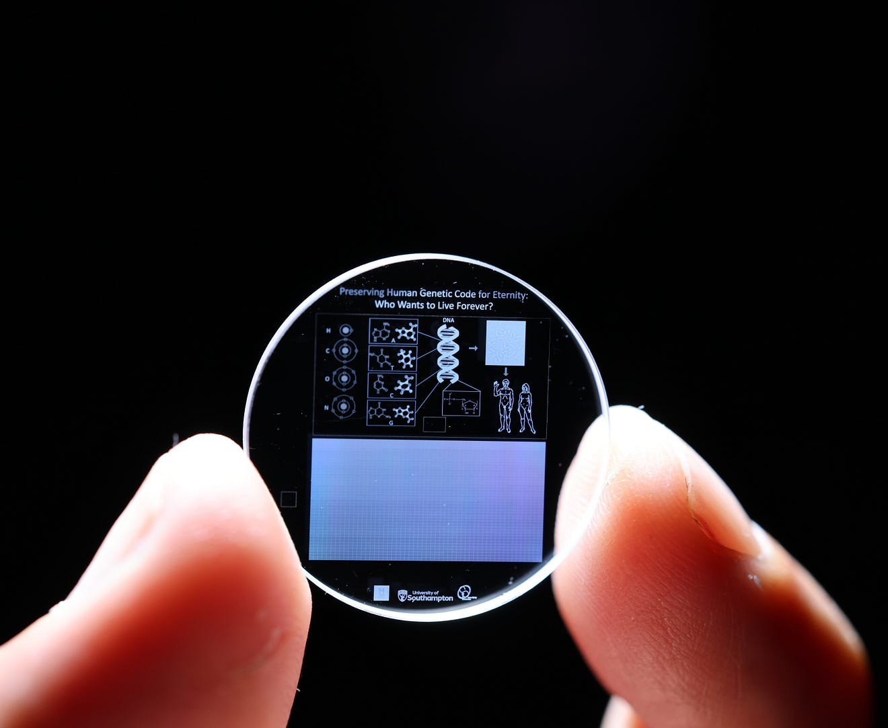
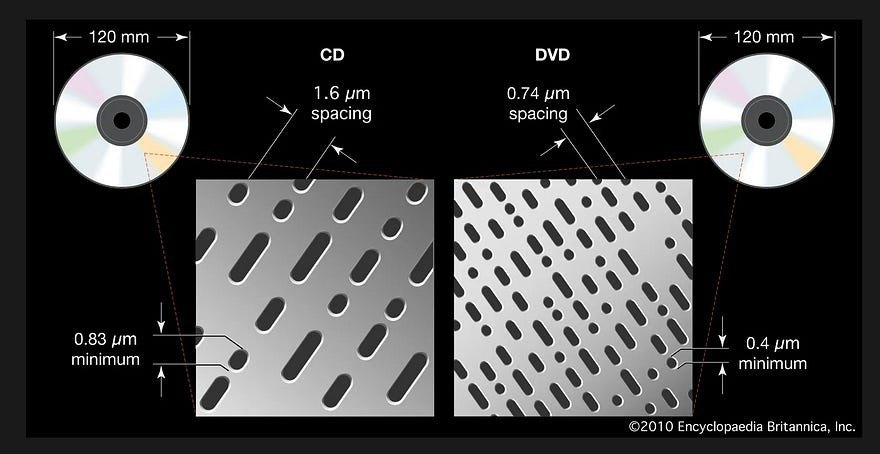
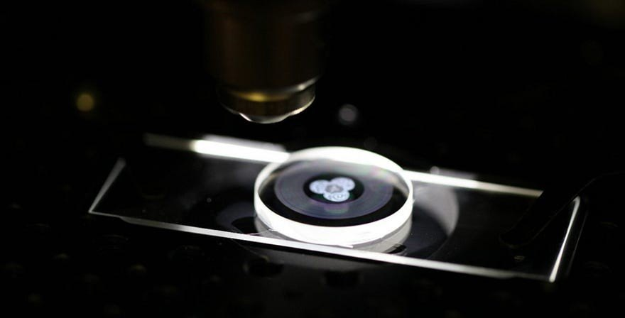
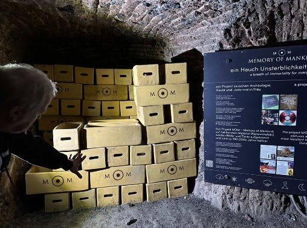
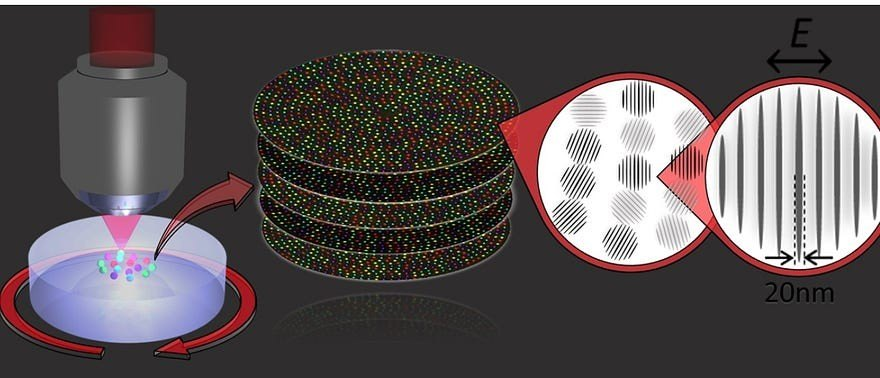

Henüz zamanda yolculuk bulunmamış olmasına rağmen bilim, *DNA* aracılığı ile bizlere geçmişi ziyaret etmeyi mümkün kılıyor. Buzullarla kaplı toprakların sakladığı nice yaşam kalıntılarının genomunu çözmek bir nevi geçmişe yolculuk deneyimi yaşatır. Geleceğe bırakabileceğimiz en güzel mesajlardan biri de geçmişin gerçekliğinin el değmemiş şekilde korunması olsa gerek. Gelecekte Sibirya’nın soğuklarına katlanarak donmuş topraklarda geçmiş yaşamın ayak izlerini bulmak için yeni keşifleri beklemek zorunda kalmayacak yeni nesiller. *Malzeme Bilimi’nin* bu konuda insanlığa bir sürprizi var!

<figure style="max-width:520px;margin-left:auto;margin-right:auto">
  
  <figcaption><a href="https://www.southampton.ac.uk/news/2024/09/human-genome-stored-on-everlasting-memory-crystal-.page" title="Kaynak: southampton.ac.uk"><strong>Ölümsüzlük Kristali</strong></a> Fotoğraf: University of Southampton</figcaption>
</figure>

**[Southampton Üniversitesi](https://www.southampton.ac.uk/ "Kaynak: southampton.ac.uk")** **[Optoelektronik Araştırma Merkezi (ORC)](https://www.southampton.ac.uk/about/faculties-schools-departments/optoelectronics-research-centre "Kaynak: southampton.ac.uk")** tarafından *5 Boyutlu Hafıza Kristali* geliştirildi.

**Nedir bu 5 Boyutlu hafıza kristali?**

**[5D](https://www.5dmemorycrystal.com/technology/ "Kaynak: 5dmemorycrystal.com")**’nin ne olduğunu anlamak için önce bir zamanlar çokça tercih edilen depolama yöntemi olan *Kompakt Diskleri (CD)* hatırlayalım. Bilgiyi depolamak için *iki boyuta* sahip olan *CD*’ler tek bir **[polikarbonat katmana](https://people.iitism.ac.in/~sarun/notes/pho303/42_dvd.html "Kaynak: people.iitism.ac.in")** sahip olup yüzeyinde bulunan küçük çukurlar sayesinde lazer ışığını yansıtıp yansıtmama durumuna göre dijital olarak 0 ve 1 şeklindeki ikili verileri aktarabilir. CD’lerden sonra geliştirilen en yaygın veri depolama yöntemi olan DVD’ler, yapılarında bulunan birden fazla katmanda çukurlar oluşturulması ile *üç boyutlu (3D)* bir depolama özelliği kazanır.

<figure>
  
  <figcaption>CD ve DVD yapısının farklarını gösteren bir <a href="https://www.britannica.com/technology/compact-disc" title="Kaynak: britannica.com"><strong>örnek</strong></a> çalışma Görsel: © 2010 Encyclopædia Britannica</figcaption>
</figure>

3D depolama teknikleri, disk üzerine fiziksel bir katman eklenmeden binlerce katman yazılmasını mümkün kılar. 3D sınırlarını aşıp optik depolama veri kapasitesini artırmak için **[*5D optik veri depolama*](https://en.wikipedia.org/wiki/5D_optical_data_storage "Kaynak: en.wikipedia.org")** ya da ***[Superman Hafıza Kristali](https://www.5dmemorycrystal.com/technology/ "Kaynak: 5dmemorycrystal.com") (Belleği)*** olarak bilinen ***özel bir malzeme*** geliştirildi. “5 boyutlu” tanımı, malzemenin üzerine veri kaydetmek için iki optik boyut ve üç mekânsal koordinat (X, Y, Z) kullanmasından geliyor; bu yüzden 5D veri kristali adını alıyor. Dijital veriler kalıcı olarak **[*femtosaniye lazer*](https://www.thorlabs.com/navigation.cfm?guide_id=2024 "Kaynak: thorlabs.com")** ile ***nano****yapılı* ***[fused silica *(erimiş kuvars)*](https://www.heraeus-conamic.com/knowlegde-base/making-of-fused-silica "Kaynak: heraeus-conamic.com")*** camının üzerine yazılıyor. Bu camı evlerin pencere camı ile karıştırmayın sakın!

<figure>
  
  <figcaption><a href="https://www.5dmemorycrystal.com/technology/" title="Kaynak: 5dmemorycrystal.com"><strong>5D Hafıza kristali</strong></a> (fused silica) Görsel: 5dmemorycrystal.com</figcaption>
</figure>

Erimiş kuvars kimyasal ve termal açıdan zorlayıcı şartlara dayanım gösteren özel bir malzemedir. Gerek çok düşük gerekse **[1000°C’ye](https://www.southampton.ac.uk/news/2024/09/human-genome-stored-on-everlasting-memory-crystal-.page "Kaynak: southampton.ac.uk")** kadar yüksek sıcaklıklara dayanabilir. Üstelik en değerli dijital bilgilerin ve genetik bilgilerin saklanması düşünülen bu özel kristale yakışır şekilde **[cm² başına 10 ton](https://www.southampton.ac.uk/news/2024/09/human-genome-stored-on-everlasting-memory-crystal-.page "Kaynak: southampton.ac.uk")** kadar doğrudan yapısına uygulanan darbelere dayanabilir ve de kozmik radyasyon saldırıları ile karşılaştığında etkilenmez. Bu demek oluyor ki hafıza kristallerinin saklandığı mağaraya ister meraklı bir ayı, isterse elinde lazer silahı ile insan türünü bitirmeyi hedefleyen bir uzaylı (!) girsin, kristaller her türlü güvendedir. Teşekkürler erimiş kuvars! :)

<figure style="max-width:460px;margin-left:auto;margin-right:auto">
  
  <figcaption>Kristaller <a href="https://www.southampton.ac.uk/news/2024/09/human-genome-stored-on-everlasting-memory-crystal-.page" title="Kaynak: southampton.ac.uk"><strong>Avusturya’nın Hallstatt</strong></a> şehrinde bir tuz mağarasında saklanıyor Fotoğraf: University of Southampton</figcaption>
</figure>

Üstelik bir silika diskin oda sıcaklığındaki ömrü 100000000 (10 üzeri 8) yıl iken, 5D optik kristalinki ondan da uzun: **[100000000000000000000 (10 üzeri 20)](https://www.5dmemorycrystal.com/technology/ "Kaynak: 5dmemorycrystal.com")** yıl.

**Peki bu veriler nasıl depolanıyor?**

<figure>
  
  <figcaption><a href="https://www.5dmemorycrystal.com/technology/" title="Kaynak: 5dmemorycrystal.com"><strong>5D optik bellek</strong></a> yapısının mikroskop altında görüntüsü Görsel: 5dmemorycrystal.com</figcaption>
</figure>

Tıpkı CD ve DVD’lerde aşina olduğumuz küçük çukurlar 5D bellekte de var, ama 20 nanometre boyutlarında! ***[Nanograt](https://www.5dmemorycrystal.com/technology/ "Kaynak: 5dmemorycrystal.com")*** (nano ızgara) olarak bilinen bu çukurlar sayesinde optik veriler yeniden yazılabilir ve silinebilir olma özelliği kazanır. Buna ek olarak, nanogratların yönelimi ve boyutu nedeniyle açığa çıkan optik çift kırılma özelliği (bir ortamın kırılma indeksinin ortama gelen (lazer) ışığın **[*polarizasyonuna ve yönüne*](https://www.5dmemorycrystal.com/technology/ "Kaynak: 5dmemorycrystal.com")** bağlı olarak değişmesidir) 5D’nin 2D’lik kısmını oluşturarak yapıya iki ekstra boyut kazandırır. Bu boyutlar da yapıdaki dördüncü ve beşinci boyutlarla birleştiğinde, sonuç olarak 12 cm ebatlarındaki belleğin yüzlerce terabayt depolama kapasitesine ulaşması mümkün hale gelir.

Dünya üzerinde iklim krizinin ya da insanlığın kendisini yok etme durumuna getirecek hatalarının bir sonucu olarak yeniden bilinmezliğe dönülse bile, kim olduğumuzu hatırlatacak bilgilerin bir yerlerde *Malzemelerin güvencesi* ile saklanabilecek olmasını bilmek insanın içini rahatlatıyor.

Sahi sizi siz yapan izlerinizin, bilgilerinizin, anılarınızın ya da genetik kodunuzun milyarlarca yıl saklanmasını ve sonra bir yabancının elinde açığa çıkmasını ister miydiniz?
