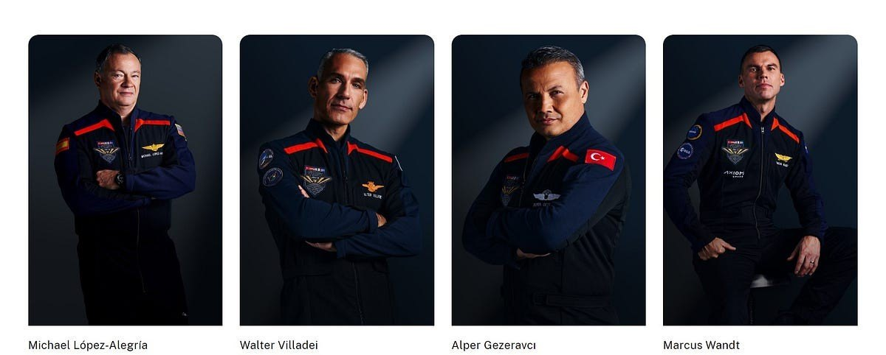
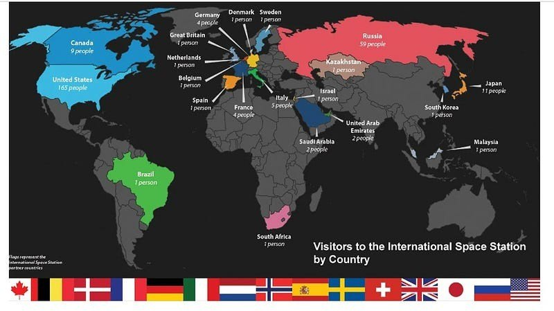
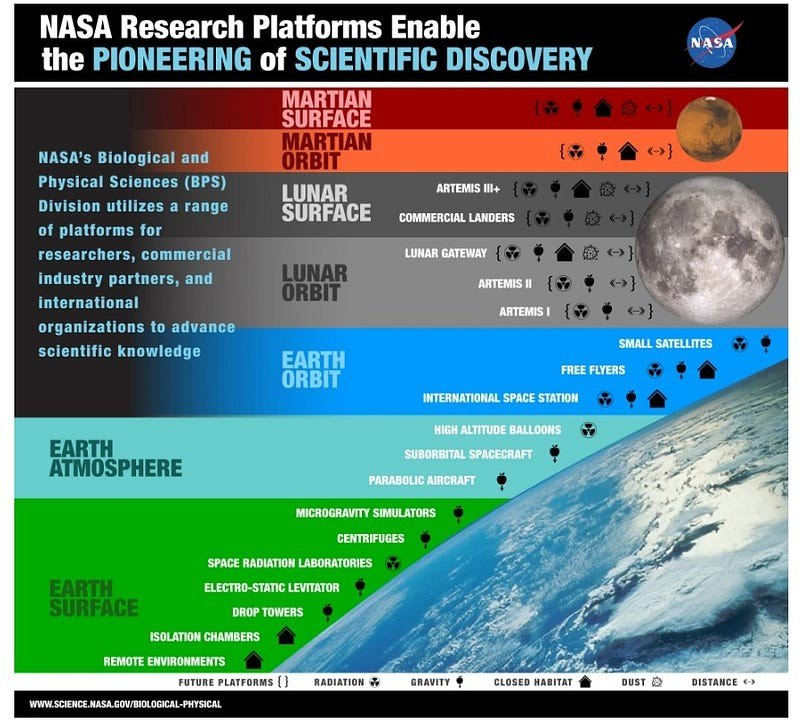
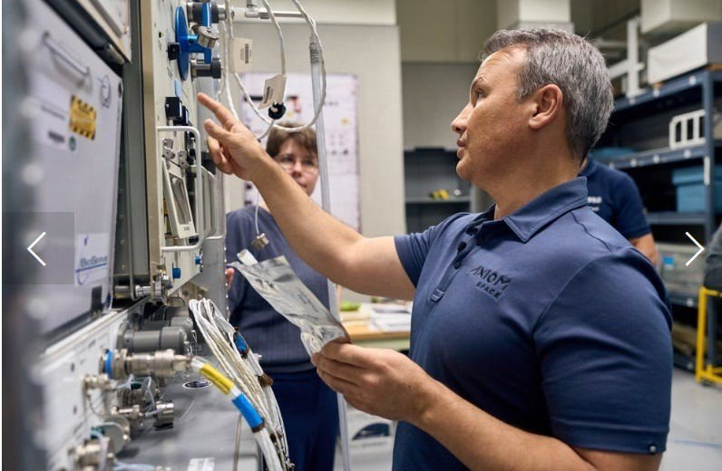
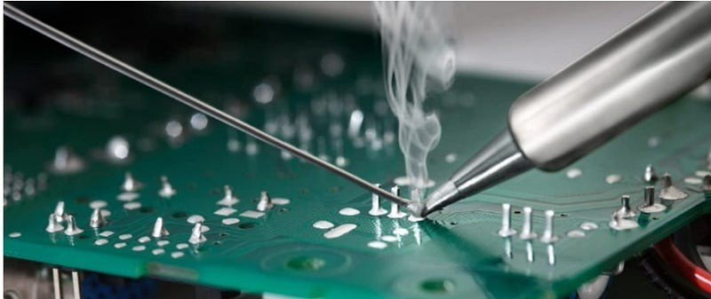
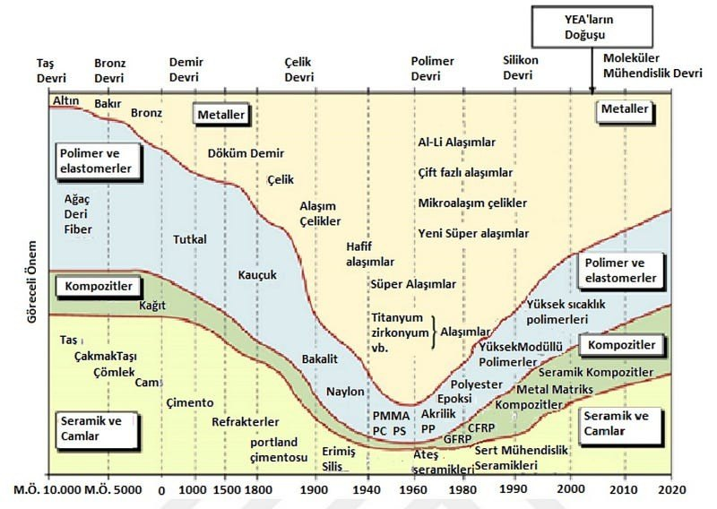
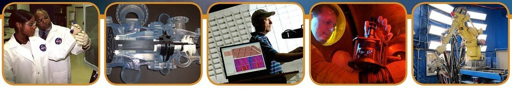

Türkiye için tarihi olayların yaşandığı önemli bir haftadayız, çünkü **[Alper Gezeravcı](https://www.bbc.com/turkce/articles/cv2lj9n72wzo "Kaynak: bbc.com")** Cumhuriyet’in 100. yılında Türkiye’nin insanlı ilk uzay görevinde yer alarak, **[Carl Sagan](https://tr.wikipedia.org/wiki/Carl_Sagan "Kaynak: tr.wikipedia.org")**’ın **[*soluk mavi nokta*](https://www.math.mcgill.ca/~rags/PaleBlueDot.html#:~:text=There%20is%20perhaps%20no%20better,home%20we've%20ever%20known. "Kaynak: math.mcgill.ca")** olarak adlandırdığı evimize, Dünya’ya uzaydan bakış atanlardan biri oldu. **[Axiom Mission 3](https://www.axiomspace.com/missions/ax3/research "Kaynak: axiomspace.com")** (Ax-3) adı verilen ve **[Axiom Space](https://www.axiomspace.com/ "Kaynak: axiomspace.com")** tarafından gerçekleştirilen bu görev, Alper Gezeravcı gibi askeri pilotluk tecrübesi olan mürettebat üyelerinden oluşuyor.

<figure>
  
  <figcaption><a href="https://www.axiomspace.com/" title="Kaynak: axiomspace.com"><strong>Axiom</strong></a> Mission 3 Ekibi Görsel: axiomspace.com</figcaption>
</figure>

**[SpaceX Falcon 9](https://www.spacex.com/vehicles/falcon-9/ "Kaynak: spacex.com")** roketi Axiom-3 mürettebatını **[SpaceX Dragon](https://www.spacex.com/vehicles/dragon/ "Kaynak: spacex.com")** uzay aracıyla **[NASA Kennedy Uzay Merkezi](https://www.kennedyspacecenter.com/launches-and-events/events-calendar/2024/january/rocket-launch-spacex-falcon-9-axiom-3 "Kaynak: kennedyspacecenter.com")**’nden Uluslararası Uzay İstasyonu’na fırlatırken herkes gibi ben de ekranın başından ayrılamadım. Roketin havalanmasını izlerken heyecan ve korku birbirine karıştı, gözlerimi kısarak takip edebildim. :) Uzay aracının **[1,5 gün](https://twitter.com/TCSanayi/status/1747359268171325494/photo/2 "Kaynak: x.com/TCSanayi")** süren yolculuğunun sonunda istasyona kenetlenmesi ile Alper Gezeravcı’nın **[14](https://twitter.com/TCSanayi/status/1747359268171325494/photo/2 "Kaynak: x.com/TCSanayi")** günlük uzay macerası da başlamış oldu.

Tüm bilimseverler gibi benim de bu yolculuk boyunca en çok merak ettiğim şeylerden biri, Alper Gezeravcı’nın uzayda gerçekleştirmesi planlanan **[13](https://twitter.com/TCSanayi/status/1747359268171325494/photo/3 "Kaynak: x.com/TCSanayi")** deney, özellikle ***malzeme bilimi*** deneyleri. Tabii yalnızca Türkiye’nin değil, mürettebattaki diğer ülkelerin de uzay şartlarında gerçekleştirmeyi planladığı deneyleri var. NASA’nın paylaştığı son verilere bakınca 21 ülkeyi ve 5 Uluslararası Ortağı temsilen 273’ün üzerinde kişinin Uluslararası Uzay İstasyonu’nu ziyaret ettiği görülmekte. Ne mutlu ki Türkiye de artık bu listede yer alabilecek.

<figure>
  
  <figcaption>Ülke bazında Uluslararası Uzay İstasyonu <a href="https://www.nasa.gov/international-space-station/space-station-visitors-by-country/" title="Kaynak: nasa.gov"><strong>ziyaretçi sayıları</strong></a> Görsel: nasa.gov</figcaption>
</figure>

Ziyaretçi sayılarından anlaşılacağı üzere Amerika 165, Rusya ise 59 kişi ile astronotları ile uzay istasyonunda en çok zaman geçiren ülkeler.

**Peki bu ziyaretçiler ne için uzayda?**

<figure>
  
  <figcaption>NASA’nın Biyolojik ve Fiziksel Bilimler Bölümü <a href="https://science.nasa.gov/biological-physical/focus-areas/" title="Kaynak: science.nasa.gov"><strong>(BPS)</strong></a> uzayın farklı katmanlarında çalışma imkanı sunuyor Görsel: NASA</figcaption>
</figure>

Uzay araştırmaları birçok farklı alana yayılmış durumda. *Hücre ve Moleküler Biyoloji, Hayvan Biyolojisi, Bitki Biyolojisi, Gelişim, Üreme ve Evrimsel Biyoloji, Mikrobiyoloji* gibi alt dallara ayrılarak gerçekleştirilen araştırmaları içeren **[*uzay biyolojisinin*](https://science.nasa.gov/biological-physical/focus-areas/ "Kaynak: science.nasa.gov")** temel amacı, uzay uçuşunun uzay aracındaki canlı sistemleri nasıl etkilediğinin daha iyi anlaşılmasına yardımcı olmak; fakat bu keşifler Dünya’daki yaşam için de oldukça değerli sonuçları beraberinde getirme potansiyeline sahip. Örneğin uzayda yara iyileşmesini destekleyen ilaçların araştırılması, Dünya’da çok sık karşılaşılan ve hastaların yaklaşık %80’ini kadınların oluşturduğu kemik erimesi **[(osteoporoz)](https://tr.wikipedia.org/wiki/Osteoporoz "Kaynak: tr.wikipedia.org")** sorununa karşı tasarlanan tedavilerin geliştirilmesine öncülük edebilir!

Elbette yalnızca biyoloji değil, NASA bilimin bir diğer önemli dalı olan **[*Fizik*](https://science.nasa.gov/biological-physical/focus-areas/ "Kaynak: science.nasa.gov")** *bilimi* alanında da yaptığı araştırmalarını altı farklı kategoriye ayırarak yürütüyor: *Temel Fizik, Biyofizik, Yanma Bilimi, Akışkan Fiziği, Yumuşak Madde Fiziği* ve tabii ki ***Malzeme Bilimi!***

NASA’nın malzeme alanında gerçekleştirmiş olduğu deneylerin **[*teknik raporlarına*](https://ntrs.nasa.gov/search?q=materials%20science "Kaynak: ntrs.nasa.gov")** bugün kolaylıkla ulaşabiliyoruz. **[*Malzeme Bilimi*](https://science.nasa.gov/biological-physical/focus-areas/materials-science/ "Kaynak: science.nasa.gov")** araştırmaları da kendi içinde dallara ayrılarak yürütülüyor. Bu araştırmaların, sürekli yörüngede hareket halinde olduğu için yer çekimi ile **[merkezkaç kuvvetinin](https://tr.wikipedia.org/wiki/Uluslararas%C4%B1_Uzay_%C4%B0stasyonu "Kaynak: tr.wikipedia.org")** dengelenmesi sonucu neredeyse ***ağırlıksızlığa*** yakın bir ortamda çalışma imkanı sunan Uluslararası Uzay İstasyonu’nda gerçekleştirilmesi, malzemelerin özelliklerinin geliştirilmesi ve anlaşılabilmesi açısından çok önemli. Elde edilen bilimsel anlayış ve bilgiler daha sonra dünya pazarında endüstriyel süreçlerde daha iyi, daha ucuz ve aranan özellikte malzemeler elde etmek için kullanılabilir! Mesela Alper Gezeravcı’nın gerçekleştireceği **[MİYOKA](https://tua.gov.tr/tr/haberler/turk-uzay-yolcusu-uzayda-13-farkli-deney-yapacak "Kaynak: tua.gov.tr")** isimli deneyde ***Mikro yerçekimi ortamında kurşunsuz lehimleme*** araştırılacak.

<figure>
  
  <figcaption>Alper Gezeravcı uzay yolculuğu öncesi <a href="https://www.axiomspace.com/missions/ax3" title="Kaynak: axiomspace.com"><strong>eğitimde</strong></a> Fotoğraf: axiomspace.com</figcaption>
</figure>

Alper Gezeravcı’nın uzay ortamında elektronik devre kartı üzerine kurşunsuz bir bileşen lehimlemesi bekleniyor. Dünya’ya dönüş sonrası deney sonuçlarının **[*TÜBİTAK UZAY*](https://uzay.tubitak.gov.tr/ "Kaynak: uzay.tubitak.gov.tr")** tarafından incelenerek yerçekimsiz ortamın kurşunsuz lehimleme üzerindeki etkilerinin raporlanması planlanmakta.

<figure>
  
  <figcaption><a href="https://www.ersaelektrik.com/tel-lehim-nedir-kullanim-alanlari-ve-ozellikleri/#:~:text=Kur%C5%9Funsuz%20lehim%20teli%20genellikle%20kalay,183C%2C%20Kur%C5%9Funsuz%20Lehim%20217)%20." title="Kaynak: ersaelektrik.com"><strong>Lehimleme</strong></a> elektrik ve elektronik sektörlerinde sıklıkla tercih edilen tamir ve üretim yöntemi olarak kullanılır Görsel: ersaelektrik.com</figcaption>
</figure>

Genelde **[kalay, gümüş ve bakır](https://en.wikipedia.org/wiki/Solder#Lead-free "Kaynak: en.wikipedia.org")** içeren kurşunsuz lehim telleri, kurşunlu tellere göre daha maliyetlidir. Çevre ve insan sağlığına zarar vermeden montaj imkanı sunuyor olsa da **[kurşunsuz lehimleme](https://www.hakko.com/english/namari/pages/ "Kaynak: hakko.com")** yönteminin lehim bölgesinde çatlak oluşumu, fazla ısınma, kopma gibi olumsuz yönleri de var. Bu ve benzeri açılardan düşünülünce, deney sonuçlarının ne gibi yenilik sunacağı şimdiden merak konusu.

**Bu kadar mıydı?**

**Tabii ki hayır!**

Metallerin özelliklerinin iyileştirilmesi denince akla gelen en yaygın yöntemlerden biri **[alaşımlamadır](https://tr.wikipedia.org/wiki/Ala%C5%9F%C4%B1m "Kaynak: tr.wikipedia.org")**. Uzayda gerçekleştirilmesi planlanan deneylerden bir diğeri de tam bununla ilgili: ***[UYNA](https://tua.gov.tr/tr/haberler/turk-uzay-yolcusu-uzayda-13-farkli-deney-yapacak "Kaynak: tua.gov.tr")***, yani uzun adı ile ***Uzay için Yeni Nesil Alaşımlar.***

<figure>
  
  <figcaption>Malzemelerin tarihsel gelişimi ve <a href="https://acikbilim.yok.gov.tr/bitstream/handle/20.500.12812/404779/yokAcikBilim_10190676.pdf?sequence=-1" title="Kaynak: acikbilim.yok.gov.tr"><strong>YEA’ların doğuşu</strong></a> Görsel: acikbilim.yok.gov.tr</figcaption>
</figure>

Araştırılacak olan alaşımlar, geleneksel iki metalin homojen karışımı ile elde edilen alaşımlardan oldukça farklı. **[*Yüksek entropili alaşımlar (YEA)*](https://acikbilim.yok.gov.tr/bitstream/handle/20.500.12812/404779/yokAcikBilim_10190676.pdf?sequence=-1 "Kaynak: acikbilim.yok.gov.tr")** olarak bilinen malzemeler, en az beş temel elementin %5 ile %35 arasındaki atomik konsantrasyonlarından oluşmakta. YEA’lar **[metaller arası bileşiklerle](https://en.wikipedia.org/wiki/Intermetallic "Kaynak: en.wikipedia.org")** kıyaslandığında yüksek karışım entropisi etkisine sahiptir. Bu etki, yapısında bulunan basit katı çözelti fazdan kaynaklanır. Bir malzemenin yapısında yüksek **[entropiye](https://tr.wikipedia.org/wiki/Gibbs_serbest_enerjisi "Kaynak: tr.wikipedia.org")** sahip düzensiz faz olması, düşük entropiye sahip düzenli fazların olmasına göre, malzeme yüksek sıcaklıklara maruz kalınca yapısında bulunan bazı düzenli fazların bastırılmasına yardımcı olacağından daha avantajlı bir durumdur. Bu özel durum bize malzemelerin kompozisyonlarının, mikro ve makro yapılarının istenilen şekilde kontrol altına alınabilme olanağı sunar ve hâliyle YEA’ları bilimsel araştırmalarda ve endüstriyel uygulamalarda ilgi çeken bir malzeme haline getirir. Savunma sanayi uygulamalarında, özellikle havacılık ve uzay teknolojileri alanında kullanılması hedeflenen yeni nesil malzemelerin ekstrem sıcaklık ve basınç değişimlerine ayak uydurması ve yüksek dayanımlı olması istenmekte. Bu amaçla üretilmiş olan yüksek entropili yeni nesil uzay alaşımlarının ergitme ve katılaşma süreçlerinde yer çekimsiz ortamın etkisini araştırmak, yeni bilimsel kazanımlar elde edilmesi açısından oldukça önemli.

<figure>
  
  <figcaption><a href="https://smd-cms.nasa.gov/wp-content/uploads/2023/05/5_565173b_mpl.pdf" title="Kaynak: nasa.gov"><strong>Marshall Uzay Uçuş Merkezi Malzeme ve Proses Laboratuvarı</strong></a> uzayda karşılaşılan sorunlara çözüm olacak malzeme üretimine odaklanıyor Görsel: NASA</figcaption>
</figure>

Alaşımlama, özellikle uzay koşullarına dayanabilecek metallerin üretimi ve geliştirilmesi, NASA’nın 50 yılı aşkın süredir **[*Marshall Malzeme ve Proses Laboratuvarı*](https://smd-cms.nasa.gov/wp-content/uploads/2023/05/5_565173b_mpl.pdf "Kaynak: nasa.gov")**’nda devam etmekte. Bu konularda **[*TÜBİTAK MAM*](https://mam.tubitak.gov.tr/ "Kaynak: mam.tubitak.gov.tr")**’ın da araştırmalar yapması ve de uzay koşullarında gerçekleştirilecek deney planlaması oldukça heyecan verici bir gelişme.

**Dünya’da bizi heyecanlandıran şeyleri uzayda bulabilir miyiz?**

<figure>
  
  <figcaption>Sıcak hava balonları <a href="https://www.flypgs.com/gezi-rehberi/kapadokya" title="Kaynak: flypgs.com"><strong>Kapadokya’da</strong></a> süzülürken Fotoğraf: flypgs.com</figcaption>
</figure>

Uzay İstasyonu, malzemeleri incelemek için Dünya’da bulunması pek de kolay olmayan imkanlar sunar. Mesela günlük yaşantımızda kaldırma kuvvetinin etkilerini deneyimliyoruz. Güzelim İstanbul Boğazı’nda süzülen teknelerin yüzmesini, Kapadokya’da gün doğuşu ile yükselen sıcak hava balonlarının uçmasını sağlayan şey **[kaldırma kuvvetidir](https://en.wikipedia.org/wiki/Buoyancy "Kaynak: en.wikipedia.org")**. İlkokulda zeytinyağı ve suyu karıştırıp yoğunluğun ne demek olduğunu, farklı sıvıların farklı yoğunluğa sahip olduğunu hep gözlemleyerek öğrendik. Etrafta hareket eden, birbirleriyle ya da çevredeki bir nesneyle çarpışan tüm sıvı moleküllerinin kinetik enerjisi bir **[basınç](https://www.boydcorp.com/blog/buoyancy-drives-natural-convection.html "Kaynak: boydcorp.com")** oluşturur. Kaldırma kuvveti olarak adlandırdığımız bu kinetik enerji her yöne doğru itme eğilimindeyken buna karşı çıkan bir de yer çekimi vardır! Bu çekişmelerin varlığı deneyin gidişatını etkileyebilir. İşte Uzay İstasyonu, deney gözlemlerini etkileyen **[çökelme](https://science.nasa.gov/biological-physical/focus-areas/materials-science/ "Kaynak: science.nasa.gov")** ya da kaldırma kuvvetinin neden olduğu konveksiyon etkisini ihmal edilebilir seviyelere getirir.

**Oh be, şöyle rahat rahat bir gözlem yapmak varmış! :)**

Hal böyle olunca da araştırmacılar malzeme süreçleri üzerindeki farklı etkilerin rolünü daha iyi kavrayabilir, netleştirebilirler. Bu durumdan yararlanarak gerçekleştirmek istediğimiz bir deney var!

**[gMETAL](https://tua.gov.tr/tr/haberler/turk-uzay-yolcusu-uzayda-13-farkli-deney-yapacak "Kaynak: tua.gov.tr")**

Yani ***Katı Fazdaki Parçacıkların Bir Akışkan İçindeki Dinamiğine Yerçekimsiz Ortam Etkisini*** konu alan deney. Hedef, uzay araçlarının itki sistemlerini daha verimli hâle getirmek. Gözlem yapmanın sorunsuz olduğu, yerçekimi etkisi ve kimyasal tepkime olmayan koşullarda malzemelerin davranışları, şekilleri ve özellikleri değişebilir. Bunun için katı parçacıklar ile oluşturulan akışkan bir ortam arasında homojen bir karışım oluşturulması durumunda yerçekiminin etkisi araştırılacak. Malzeme bilimine ulusal ve uluslararası araştırmalarda katkı sağlayacak olan bu ve diğer iki deneyin sonuçlarını öğrenmek için birazcık beklememiz gerekecek.

Bu süre boyunca tek yapmamız gereken şey ise bizi daha iyi bir geleceğe hazırlayan malzemelerin ayak seslerine kulak vererek ilerlemeye, sorgulayarak öğrenmeye devam etmek.
